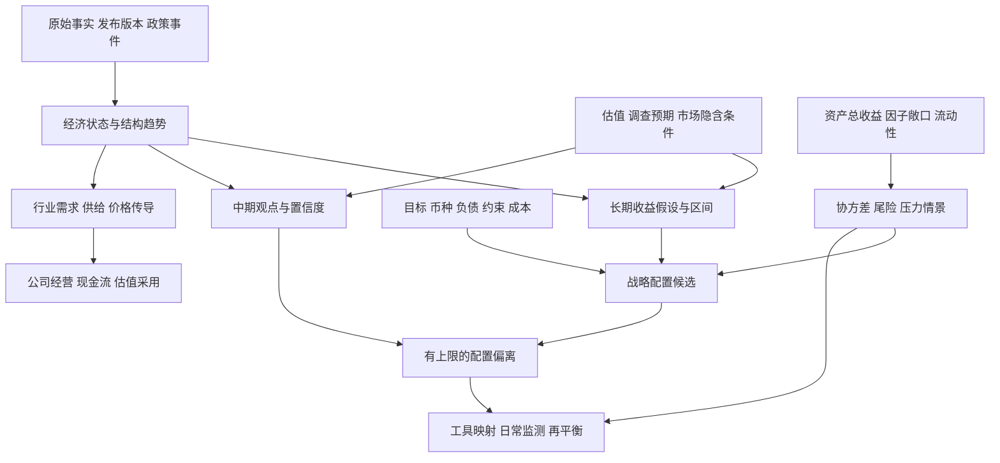

# 全球宏观与大类资产配置详细设计

日期：2026-10-14。状态：设计提案 `proposed`，待用户审阅。适用范围：全球研究，中美为重点；人民币全球组合为主，美元美国组合单独建模；长期配置为主，兼顾中期调整、日常风险监测和行业公司研究。

核心建议是建立一套**由经济机制、市场定价、风险预算和实际约束共同驱动的配置体系**。宏观指标用于识别环境和检验假设，各资产的长期收益需要分别解释来源，最终配置取决于投资者目标、价格和承担风险的能力。增加可取得的指标与资产只是第一步，关键是把它们放在正确的决策层。

例如，美国经济强劲既可能支持企业盈利，也可能令利率更高。美股是否值得增配还取决于市场已经预期多少、估值与风险溢价是否合理；人民币投资者还需要考虑汇率及对冲。一个“增长偏强”的标签不能同时回答这些问题。

## 阅读顺序

| 文档 | 重点回答 |
| --- | --- |
| [宏观指标体系](01-宏观指标体系.md) | 研究哪些经济事实、预期和风险，定义、频率、来源、变换与用途是什么 |
| [资产分类与基准](02-资产分类与基准.md) | 全球资产怎样拆分，如何避免重复暴露，收益与基准如何统一 |
| [模型与组合方案](03-模型与组合方案.md) | 如何估计长期收益与风险，如何配置、调整、监测，典型约束怎样设置 |
| [数据口径与验证设计](04-数据口径与验证设计.md) | 发布和修订如何进入模型，怎样避免前视偏差，未来如何验证 |
| [研究接口与实施顺序](05-研究接口与实施顺序.md) | 如何衔接行业公司研究，旧框架怎样迁移，后续从哪里实施 |

本轮交付包含指标目录、资产和基准候选、公式与模型选择、示例约束、数据契约和验证顺序。未采集金融序列、未写计算程序、未运行回测；文中的参数范围或算例均不构成当前配置建议。

## 1 用户要求与设计选择

| 已确认要求 | 设计采用 |
| --- | --- |
| 资产配置为主，兼顾研究链 | 组合决策和行业公司采用各有出口，共享证据、版本与经济机制 |
| 全球覆盖，中美重点 | 中美完整指标面板；欧元区、日本、英国及主要新兴经济体采用共同小面板，再按暴露增加专题 |
| 人民币为主，美国美元 | `CNY_GLOBAL` 与 `USD_US` 两个政策组合；美国资产进入前者时仍转为人民币总收益 |
| 先全面研究，限制另设 | 完整研究资产树与首轮可建模资产池分开；工具准入、税、杠杆与额度到实施层约束 |
| 长期为主 | 长期收益假设以 5—10 年为主要研究期限，3—5 年评估战略配置适用性；不混同持有期与数据更新频率 |
| 兼顾中期和监测 | 中期 3—12 个月观点只产生有上限的偏离；日常风险监测不自动重写长期收益假设 |
| 约束未定 | 提供几类典型任务与参数模板，不先指定一组“最优权重” |
| 数据不再限制设计 | 指标按决策价值选取；历史时点版本、定义可比性与成本仍要在实施时验证 |

`USD_US` 指以美国经济/市场暴露为主、美元计价的独立研究组合，可包含用于该组合分散风险的美元现金、美国国债、信用债和相应实物/策略暴露；它不等于“人民币组合中的美国持仓截图”。若以后要建立美元全球组合，应另设任务，不能悄然扩展 `USD_US`。

## 2 体系结构

信息进入组合之前经过三道经济判断：它是否改变现金流或风险；价格是否已经反映这种变化；在约束和成本之后是否值得调整。多个指标共同描述一个机制时，先检验增量信息，再决定是否入模。

## 3 三种决策节奏

| 层 | 主要问题 | 更新与行动 | 主要输出 |
| --- | --- | --- | --- |
| 长期战略 | 未来多个经济周期，哪些资产能提供怎样的真实现金流与风险补偿 | 年度全面审视，季度检查估值/结构变化；重大制度变化可提前重审 | 5—10 年 CMA 区间、战略候选组合、风险预算与反证 |
| 中期调整 | 未来 3—12 个月，相对市场定价有哪些有根据的偏离 | 月度审视、事件触发复核；不以每次数据发布机械交易 | 观点、证据、期限、信心、最大偏离和失效条件 |
| 日常风险 | 当前持仓能否承受价格、相关性与流动性变化 | 日常或事件监测；超限先核实，再按预先约定规则处理 | 敞口、尾损失、保证金、变现能力、集中度与异常 |

每天更新风险估计不等于每天再平衡；季度更新 CMA 不等于季度推翻战略。若中期模型没有经过有效验证，仍可输出解释和风险提示，配置维持战略规则。

## 4 指标选择原则的升级

1. **先问问题，再选指标。** 每项指标必须对应状态识别、长期假设、定价比较、风险测量或约束中的至少一种用途。
2. **研究广度与模型复杂度分开。** 允许多个来源和指标交叉核验；单个模型只使用有新增信息且样本能支持的特征。
3. **区分水平、变化与预期差。** 同比高不一定继续改善，改善不一定超预期，超预期也不保证资产回报为正。
4. **尊重制度和结构。** 中美的财政、银行信用、房地产和资本市场机制不同；一个全球标准分数只作摘要，不能代替地区解释。
5. **长期历史是证据而非准入执照。** 有断点的 20 年序列不必然优于定义清楚的短序列；短历史资产的风险要另外约束。
6. **每个结论带传导条件。** 利率、通胀、增长对资产的影响依冲击来源、估值、政策反应和资产敞口而变化。

## 5 资产研究范围

研究资产涵盖现金与短票、名义主权债和政策性债、通胀挂钩债、不同信用等级和结构的债券、全球股票、黄金、分板块商品、上市房地产与基础设施、私募股权/创投/债务/实物资产、系统化与主动策略、保险风险和数字资产。

这些类别不能全部直接并列进一个优化器。股票地区拆分需互斥；REITs 与宽基权益重叠要穿透；CTA 是交易策略而非一种商品；期权是实施工具，其风险取决于持仓方向与期限；外汇是独立敞口及对冲维度；私募还需处理现金承诺、估值滞后与退出限制。详细规则在资产章固定。

起步模型优先使用定义清楚、可比较、历史与实施条件可核验的流动资产。卫星资产只有在改善经济暴露并能够测量其成本、现金流和风险后才纳入，避免为了“覆盖全面”引入不可解释的分散效果。

## 6 模型路线

| 工作 | 首选设计 | 复杂方法的启用条件 |
| --- | --- | --- |
| 宏观状态 | 分地区的经济机制面板，必要时使用透明综合信号 | 混频/动态因子改善实时预测且结果可解释后采用；状态概率不直接当资产权重 |
| 长期预期收益 | 各资产收益来源分解，估值回归和结构参数给区间 | 机构 CMA 只作对照，不能取平均替代自己的假设 |
| 风险 | 收缩协方差与经济因子解释，辅以情景压力 | EWMA/状态条件/尾险模型分别验证，不能用一个历史相关矩阵承诺分散 |
| 战略配置 | 有约束的稳健配置，展示多个可接受方案与代价 | 优化器只有在目标、币种、期限、输入与约束一致时才有意义 |
| 中期观点 | 受限偏离、到期复核和失效条件 | Black–Litterman 等融合方法需要明确先验、观点和误差；无观点时回到战略基线 |
| 风险对照 | 简单静态配置和风险预算作为基准 | 更复杂模型须证明增量价值覆盖成本与不稳定性 |

方法文献与公式在各章相邻引用。数据的时点设计参考 [ALFRED](https://alfred.stlouisfed.org/help/downloaddata)，全球宏观汇总的权重区分参考 [IMF WEO 方法问答](https://www.imf.org/en/Publications/WEO/frequently-asked-questions)。这些资料支持定义和方法，不代表本设计的指标数量、参数或组合已经校准。

## 7 典型约束如何使用

模型章给出四套示例模板：**人民币流动性优先、人民币长期均衡、人民币长期增长、美元美国组合**。模板用于比较问题，不能用名称代替投资者要求。流动性优先仍可能亏损；长期增长不能通过把股权风险改名为私募风险来降低账面波动；长期购买力目标也不能假定商品与黄金在每次通胀冲击下都有效。

模型章给出可调参数和检验方式。正式产生权重前，至少确定：目标和评价基准、基础币种、资金用途及负债、可承受损失、最低流动性、可用工具、集中度、未对冲外汇、杠杆和保证金。尚未确定的约束应在方案比较中显示影响，而不是隐藏成默认值。

## 8 本轮边界与下一步

这是一份独立设计，不改变 [现行 SPEC](../../../SPEC.md)，也不改写 [旧宏观导入材料](../../imports/landing-zone-macro/README.md) 的参考身份。正式宏观研究的截点、来源入库、原作者责任、版本冻结和行业公司采用仍遵守项目规则；配置研究的新情景不覆盖长飞现有三情景。

建议先审阅指标与资产拆分是否符合研究用途、模型主线是否可解释、典型约束是否覆盖实际需求，再选择一个人民币和一个美元小型组合做样本验证。样本取数、编程和回测是下一阶段任务，本轮止于详细设计。
